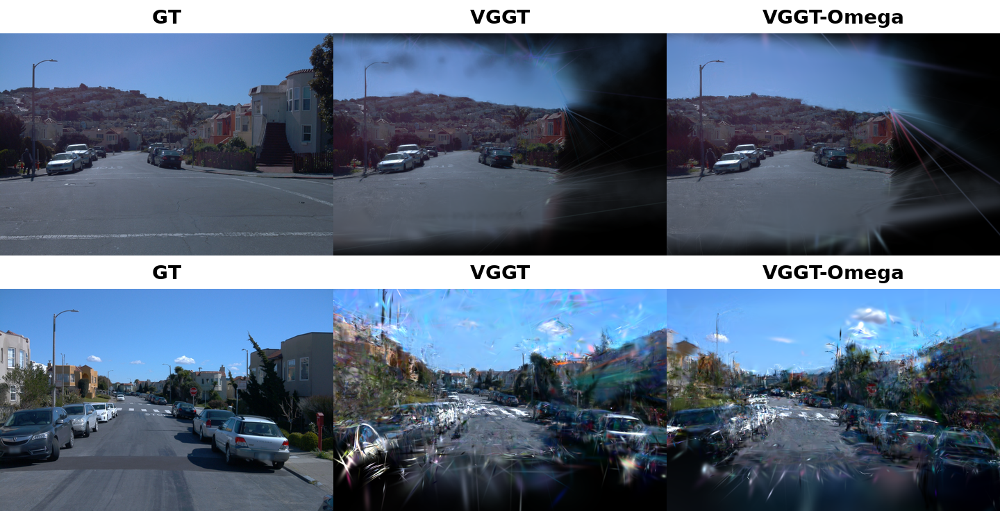
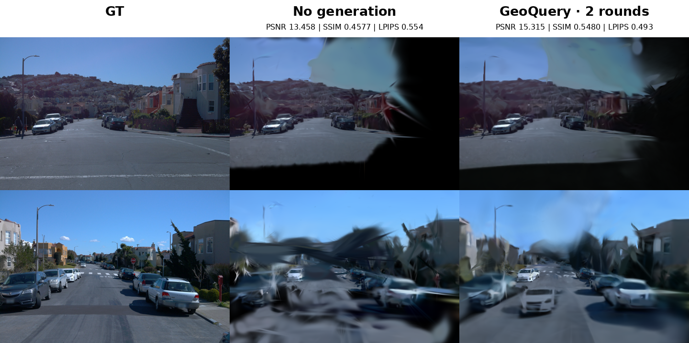
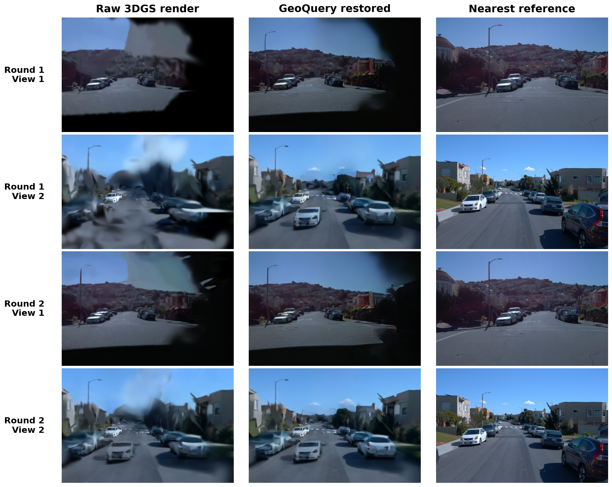

# Generative Sparse-View 3D Reconstruction

This project studies 3D scene reconstruction from sparse input images. We compare classical COLMAP, VGGT, and VGGT-Omega for camera and geometry initialization, followed by 3D Gaussian Splatting (3DGS). We also evaluate GeoQuery as a generative refinement method for improving sparse-view reconstruction.

## Pipeline

1. Select sparse or dense input views.
2. Estimate camera poses and initial geometry using:
   - COLMAP
   - VGGT
   - VGGT-Omega
3. Export the reconstruction in COLMAP format.
4. Optimize a 3D Gaussian Splatting scene.
5. Evaluate novel-view synthesis using PSNR, SSIM, and LPIPS.
6. Optionally apply GeoQuery refinement and continue optimization.

## Main Findings

- COLMAP provides the strongest dense-view result when image overlap is sufficient.
- COLMAP may fail or register very few cameras in extremely sparse settings.
- VGGT and VGGT-Omega consistently initialize all sparse input views.
- VGGT-Omega generally performs better than VGGT in our sparse-view experiments.
- GeoQuery improves sparse-view novel-view rendering over an otherwise identical no-generation control.

## Selected Results

### Dense 100-view experiment on scene 405841

| Initialization | PSNR | SSIM | LPIPS |
|---|---:|---:|---:|
| COLMAP | 30.1713 | 0.9071 | 0.2356 |
| VGGT | 21.3782 | 0.7444 | 0.4071 |
| VGGT-Omega | 23.3418 | 0.7894 | 0.3578 |

### Sparse 10-view experiment on scene 405841

| Initialization | PSNR | SSIM | LPIPS |
|---|---:|---:|---:|
| VGGT | 13.1243 | 0.5038 | 0.5126 |
| VGGT-Omega | 13.9969 | 0.5564 | 0.4930 |

### Sparse 20-view experiment on scene 405841

| Initialization | PSNR | SSIM | LPIPS |
|---|---:|---:|---:|
| VGGT | 17.4039 | 0.6227 | 0.4452 |
| VGGT-Omega | 18.1735 | 0.6292 | 0.4304 |

### GeoQuery ablation on the sparse 10-view setting

| Method | PSNR | SSIM | LPIPS |
|---|---:|---:|---:|
| No generation | 13.458 | 0.4577 | 0.554 |
| GeoQuery, two refinement rounds | 15.315 | 0.5480 | 0.493 |

Higher PSNR and SSIM are better. Lower LPIPS is better.

## Qualitative Results

### Sparse-view initialization comparison

### GeoQuery versus no-generation control

### GeoQuery refinement rounds

## Repository Structure

    .
    ├── src/
    │   ├── vggt/
    │   └── vggt_omega/
    ├── patches/
    ├── scripts/
    ├── configs/
    ├── environment/
    ├── datasets/
    ├── results/
    │   ├── figures/
    │   └── metrics/
    ├── third_party/
    └── docs/

## Third-Party Dependencies

The project uses separately cloned upstream repositories:

- VGGT
- VGGT-Omega
- 3D Gaussian Splatting
- LightGlue
- GeoQuery

Their exact revisions are recorded in `third_party/revisions.tsv`.

Clone all repositories at the recorded revisions with:

    bash scripts/clone_dependencies.sh

They will be placed under `third_party/repos/`, which is excluded from Git.

## Model Weights

Model weights are not included because of their size and license conditions. Download them from the official project pages:

- VGGT
- VGGT-Omega
- GeoQuery
- SD-Turbo

The reconstruction scripts accept local checkpoint paths through `--checkpoint`. GeoQuery can load SD-Turbo from a local directory through the `SD_TURBO_PATH` environment variable.

## Dataset Setup

Raw datasets are not included. See `datasets/README.md` for expected directory layouts and official dataset sources.

The experiments use scenes from:

- Waymo Open Dataset
- DL3DV
- RealEstate10K

Users are responsible for following the original dataset licenses and access requirements.

## Offline Exporters

VGGT example:

    export VGGT_REPO=/path/to/vggt
    python src/vggt/demo_colmap_offline.py \
      --scene_dir /path/to/scene \
      --checkpoint /path/to/vggt_checkpoint.pt

VGGT-Omega example:

    export VGGT_REPO=/path/to/vggt
    export VGGT_OMEGA_REPO=/path/to/vggt-omega
    python src/vggt_omega/demo_colmap_omega_offline.py \
      --scene_dir /path/to/scene \
      --checkpoint /path/to/vggt_omega_checkpoint.pt \
      --conf_percentile 50 \
      --max_points 100000

Both exporters produce a COLMAP-compatible sparse reconstruction for subsequent 3DGS training.

## GeoQuery Patches

The files under `patches/` provide:

1. Offline SD-Turbo loading through `SD_TURBO_PATH`.
2. PyTorch 2.3 AMP compatibility for SoftSplat.

Apply them from the root of the cloned GeoQuery repository:

    git apply /path/to/project/patches/geoquery_offline_model.patch
    git apply /path/to/project/patches/geoquery_torch23_compat.patch

## Evaluation

Detailed metrics are available under `results/metrics/`, including:

- PSNR, SSIM, and LPIPS results
- Per-view evaluation results
- Camera trajectory ATE results
- GeoQuery ablation statistics

## Limitations

- Sparse-view reconstructions still contain floaters, blur, holes, and incomplete geometry.
- Evaluation sets are small in some sparse experiments.
- Results depend strongly on view selection and camera overlap.
- Generative refinement improves perceptual completeness but may introduce hallucinated content.
- Full training environments and large checkpoints are not distributed in this repository.

## License and Attribution

This repository contains project-specific scripts, patches, metrics, and figures. Third-party source code, model weights, and datasets remain subject to their original licenses. See `third_party/README.md` for upstream repositories.
